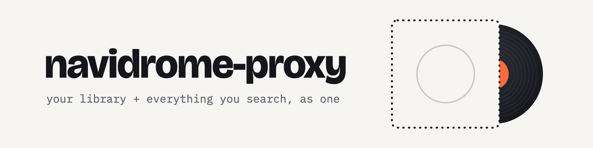

<p align="center">
  
</p>

<p align="center">
  An OpenSubsonic proxy that puts the whole music catalog inside your
  <a href="https://www.navidrome.org/">Navidrome</a> library.<br>
  Search anything, press play, and the track becomes yours.
</p>

<p align="center">
  <a href="https://github.com/daz9e/navidrome-proxy/actions/workflows/ci.yml"></a>
</p>

---

Point any Subsonic client (Arpeggi, Substreamer, Symfonium, the Navidrome web UI) at the proxy
instead of Navidrome. Nothing else changes for the client.

| You do | The proxy does |
|---|---|
| **Search** | Your library first, then Deezer and YouTube Music, deduplicated. Nothing is downloaded. |
| **Play** | Downloads the track in a priority lane (~4 s to first sound), tags it and streams it; prefetches the next tracks of the album. |
| **Like / add to playlist** | Downloads it, then sets the like or playlist entry in Navidrome itself. |
| **Open an album** | Shows downloaded and not-yet-downloaded tracks together, in order. |

**One song, one id.** Once a track is in the library, clients see the real Navidrome song
everywhere. Deezer, YouTube and SoundCloud copies of the same recording are merged.

**A clean library.** Files are remuxed (no broken DASH durations), tagged from Deezer
(all artists of a collaboration), and stored as `Artist/Album/01-03 - Title [deezer-id].m4a`.

**Better copies of liked tracks.** A background job looks on Soulseek and replaces the file
only if its audio fingerprint matches, so an instrumental never slips in.

**List import.** Paste `Artist - Title` lines at `/proxy/import`: they are matched, liked and
downloaded, optionally into a playlist in the original order.

## Run

```bash
docker compose up -d --build
```

Build locally without Docker:

```bash
cargo build --release          # binary in target/release/navidrome-proxy
cargo test                     # hermetic: no network, no fixed ports, fakes for HTTP and tools
```

The binary needs `ffmpeg`/`ffprobe`, `fpcalc` (Chromaprint) and `yt-dlp` on `PATH` (or set
`*_PATH`), and the music folder must be the same directory Navidrome scans.

## Settings

Every setting is an environment variable; a `<NAME>_FILE` variant reads the value from a file
instead (systemd credentials, agenix, sops) and wins over `<NAME>`.

| Variable | Default | |
|---|---|---|
| `NAVIDROME_URL` | `http://127.0.0.1:4533` | Navidrome address |
| `NAVIDROME_USER`, `NAVIDROME_PASSWORD` | | optional admin account (startScan needs admin; otherwise the proxy uses credentials it recently saw) |
| `MUSIC_DIR` | `/music` | the folder Navidrome scans; downloads are written here |
| `DATA_DIR` | `/data` | SQLite state, cover cache, backups |
| `HOST`, `PORT` | `0.0.0.0`, `8084` | listen address |
| `SLSKD_URL`, `SLSKD_API_KEY` | | enables Soulseek quality upgrades |
| `SLSKD_DOWNLOADS_DIR` | `/downloads-slskd` | slskd's download folder |
| `SLSKD_UPGRADES`, `SLSKD_MIN_PEERS` | `true`, `2` | upgrades on/off; identical copies required before a file is tried |
| `BACKGROUND_WORKERS` | `5` | parallel background downloads (album likes, imports, upgrades) |
| `PRIORITY_WORKERS` | `16` | parallel play/like downloads |
| `STREAM_WAIT_SECONDS` | `120` | how long a first play waits for its download |
| `EXTERNAL_SONGS`, `EXTERNAL_ALBUMS`, `EXTERNAL_ARTISTS` | `25`, `10`, `5` | catalog results per search |
| `YOUTUBE_SONGS` | `3` | YouTube-only results per search (`0` disables YouTube Music search) |
| `COMPLETE_LOCAL_ALBUMS` | `true` | show missing catalog tracks in local albums and artists |
| `PREFETCH_NEXT_TRACKS` | `2` | album tracks downloaded ahead of the one playing |
| `LYRICS` | `true` | fetch lyrics from lrclib.net next to downloads |
| `AUTH_CACHE_SECONDS` | `300` | how long accepted credentials are cached |
| `SEARCH_CACHE_SECONDS` | `120` | catalog search cache TTL |
| `SEARCH_BUDGET_SECONDS` | `4` | time budget for external searches per request |
| `DEEZER_REQUESTS_PER_SECOND` | `8` | Deezer API rate limit |
| `SCAN_DEBOUNCE_SECONDS` | `3` | coalesce Navidrome scans after downloads |
| `DURATION_TOLERANCE_SECONDS` | `10` | allowed length difference between catalog and audio source |
| `BACKUP_HOURS`, `BACKUP_KEEP` | `6`, `8` | database backup interval (`0` disables) and how many to keep |
| `YTDLP_FAST_CLIENT` | `visionos` | YouTube player client tried first (faster first play; empty falls back to yt-dlp defaults) |
| `YTDLP_ARGS` | | extra arguments for every yt-dlp call; use it to set `--extractor-args`/`player_client` yourself |
| `YTDLP_PATH`, `FFMPEG_PATH`, `FFPROBE_PATH`, `FPCALC_PATH` | | executables instead of `PATH` lookups |
| `LOG_LEVEL` | `INFO` | `ERROR`, `WARNING`, `INFO`, `DEBUG`, `TRACE` (or `RUST_LOG`) |
| `YTDLP_AUTO_UPDATE` | `1` (Docker image only) | refresh yt-dlp on start; a stale yt-dlp is the usual cause of 403s |

## Nix

```nix
{
  inputs.navidrome-proxy.url = "github:daz9e/navidrome-proxy";
  # ...
  imports = [ inputs.navidrome-proxy.nixosModules.default ];

  services.navidrome-proxy = {
    enable = true;
    musicDir = "/srv/music";          # the Navidrome music folder
    navidromeUser = "admin";
    navidromePasswordFile = config.sops.secrets.navidrome-password.path;
    ytdlpFastClient = "";             # optional: use yt-dlp's defaults
  };
}
```

`nix run . -- serve`, `nix build .#default`; the module exposes every setting above as a typed
option and the service runs with a hardened systemd unit (read-only `/` and `/home`, empty
capability set, `@system-service` syscall filter, credentials via `LoadCredential`).
`nix build .#checks.x86_64-linux.nixos` boots a VM with a real Navidrome and tests the proxy
end to end.

## Admin API and import page

- `GET /proxy/v1/health` — liveness (no auth).
- `GET /proxy/v1/status?u=&p=` — queue depths and job state; `401` on bad credentials.
- `GET|POST /proxy/v1/imports`, `GET /proxy/v1/imports/{id}` — import jobs.
- `GET /proxy/import` — paste lines of `Artist - Title`.

## Maintenance CLI

Stop the server first (except for `remux-dash`); each command prints JSON and exits non-zero
on error.

```bash
navidrome-proxy serve                     # default
navidrome-proxy migrate-legacy [--state PATH] [--legacy-music-root /music]
navidrome-proxy relayout [--dry-run]      # move files into Artist/Album, never overwrites
navidrome-proxy check-db                  # full integrity check
navidrome-proxy remux-dash [--dry-run]    # fix DASH-fragmented m4a (safe while serving)
navidrome-proxy repair-covers [--dry-run]
navidrome-proxy adopt-youtube-fallbacks [--dry-run]
navidrome-proxy recheck-import <id> [--dry-run]
```

Moving from the first (Python) version: `migrate-legacy`, `adopt-youtube-fallbacks`,
`remux-dash`, `repair-covers`, then `relayout` once Navidrome has rescanned. Verified database
backups go to `DATA_DIR/backups`.

## Develop

```bash
cargo test                       # unit + end-to-end tests (ffmpeg/fpcalc tests self-skip when missing)
cargo clippy --all-targets -- -D warnings
nix develop                      # toolchain, ffmpeg, chromaprint, yt-dlp
```

`tools/arpeggi_emulator.py` replays a real Arpeggi session against a server;
`tools/avplayer` checks playback with AVQueuePlayer, the engine Arpeggi uses.
